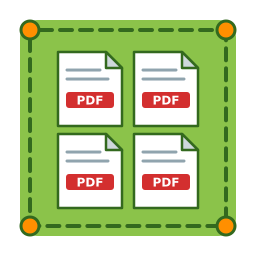

# tute-lote

Este archivo fue traducido automáticamente del original inglés con Argos Translate. Si difiere del original inglés, se aplica el original inglés.



Idiomas: [English](README.md), [Deutsch](README.de.md), [Español](README.es.md)

tute-lote lee una carpeta de documentos PDF sobre la retirada de un producto del mercado, como formularios de devolución, recibos de entrega, recibos de bienes, listas de inventarios e informes de retiro. Para cada número de lote calcula tres cantidades y las escribe a un archivo Excel:

- la cantidad retirada: piezas que fueron devueltas o recuperadas del mercado;
- la cantidad no distribuida: piezas que todavía están en inventario, tomadas de un archivo de referencia Excel;
- la cantidad total para la destrucción: la suma de ambos.

El programa no depende solamente de las palabras en los documentos. Examina la estructura de cada tabla: que columna contiene números enteros, que columna multiplicada por el precio unitario da el precio total impreso, y que columna suma hasta un total impreso. En un informe de retirada encuentra las columnas por aritmética, porque menos distribuidas no se distribuye, y no distribuidas más retiradas equivale al total.

La cantidad retirada de cada lote se compara con el archivo de referencia Excel. Ningún lote puede exceder piezas retiradas `48,042` o piezas `82,090` que no fueron distribuidas. Las piezas retiradas deben agregar exactamente a `209,908`, las piezas no distribuidas a exactamente `134,543`, y el total para la destrucción a exactamente `344,451`. Si algo no coincide, los PDF escaneados dudosos son leídos por segunda vez, las diferencias se corren sólo cuando existe una prueba exacta, y los PDF están marcados como malos sólo en pruebas concluyentes.

El programa lee el texto de PDF que contiene texto y lee PDF escaneados con reconocimiento de caracteres ópticos (OCR). Fue escrito para documentos sobre productos farmacéuticos devueltos en México. Sus mensajes y archivos de salida están en español. Un número de lote debe tener exactamente ocho dígitos y empezar con `25` o `26`. Estas reglas son fáciles de cambiar.

## Necesidades

- Python 3.9 o una versión más nueva. `Python 3.12` se recomienda, ya que el motor OCR preferido soporta las versiones de Python hasta `Python 3.12`.
- Los paquetes Python pdfplumber y openpyxl.
- Para PDF escaneados: el paquete rapidocr_onnxruntime con `Python 3.12` o una versión anterior, o los paquetes rapidocr y onnxruntime con `Python 3.13` o una versión más reciente.

En Windows y macOS no necesita derechos de administrador. En Linux y en los sistemas BSD, necesita que el usuario root instale Python desde los paquetes del sistema. En Linux se puede evitar esto con el programa uv, como describe el manual.

OCR está disponible en Windows, en macOS y en distribuciones Linux que usan glibc. En FreeBSD, OpenBSD, NetBSD y Alpine Linux, el programa sólo lee PDFs que contienen texto. Lista PDF escaneado para revisión manual.

## Inicio rápido

Windows 10 y Windows 11, en PowerShell, sin derechos de administrador:

```
$d="$env:USERPROFILE\tute-lote"; New-Item -ItemType Directory -Force "$d\python" | Out-Null; Invoke-WebRequest -UseBasicParsing https://www.python.org/ftp/python/3.12.10/python-3.12.10-embed-amd64.zip -OutFile "$env:TEMP\py-embed.zip"; Expand-Archive -Force "$env:TEMP\py-embed.zip" "$d\python"; (Get-Content "$d\python\python312._pth") -replace '^#\s*import site','import site' | Set-Content "$d\python\python312._pth"; Invoke-WebRequest -UseBasicParsing https://bootstrap.pypa.io/get-pip.py -OutFile "$d\python\get-pip.py"; & "$d\python\python.exe" "$d\python\get-pip.py" --no-warn-script-location; & "$d\python\python.exe" -m pip install pdfplumber openpyxl rapidocr_onnxruntime msvc-runtime; curl.exe -L -o "$d\lotes_auto.py" https://raw.githubusercontent.com/z4dm42f5kp-ux/tute-lote/main/lotes_auto.py; curl.exe -L -o "$d\diagnostico.py" https://raw.githubusercontent.com/z4dm42f5kp-ux/tute-lote/main/diagnostico.py
```

macOS, cuando se instala `Python 3.12`:

```
mkdir -p ~/tute-lote && cd ~/tute-lote && python3.12 -m venv venv && venv/bin/pip install pdfplumber openpyxl rapidocr_onnxruntime && curl -LO https://raw.githubusercontent.com/z4dm42f5kp-ux/tute-lote/main/lotes_auto.py && curl -LO https://raw.githubusercontent.com/z4dm42f5kp-ux/tute-lote/main/diagnostico.py
```

Linux, cuando se instala `Python 3.12`:

```
mkdir -p ~/tute-lote && cd ~/tute-lote && python3.12 -m venv venv && venv/bin/pip install pdfplumber openpyxl rapidocr_onnxruntime && venv/bin/pip uninstall -y opencv-python && venv/bin/pip install opencv-python-headless && curl -LO https://raw.githubusercontent.com/z4dm42f5kp-ux/tute-lote/main/lotes_auto.py && curl -LO https://raw.githubusercontent.com/z4dm42f5kp-ux/tute-lote/main/diagnostico.py
```

El manual describe la instalación en otras distribuciones de Linux y en FreeBSD, OpenBSD y NetBSD.

## Cómo utilizar el programa

Windows:

```
& "$env:USERPROFILE\tute-lote\python\python.exe" "$env:USERPROFILE\tute-lote\lotes_auto.py" "C:\path\to\pdfs"
```

macOS, Linux, FreeBSD, OpenBSD y NetBSD:

```
~/tute-lote/venv/bin/python ~/tute-lote/lotes_auto.py /path/to/pdfs
```

El programa también busca todos los subcarpetas. Se salta cada archivo cuyo nombre contiene `FALTA REVISION`. El archivo de referencia Excel es el archivo `Retirado_retiro_producto_Traxicoll.xlsx` en la carpeta o en un subcarpeta. Cuando el programa termina, la carpeta `resultados_lotes` dentro de la carpeta contiene estos archivos:

- totales_lotes.xlsx contiene tres tablas lado a lado en una hoja: retirada, no distribuida, y total para la destrucción, cada una con el número de lote y el número de piezas.
- detalle_lotes.txt enumera cada cantidad de cada lote, el PDF que lo contiene y si se verifica.
- revisar_a_mano.txt enumera los PDFs que están marcados como malos, las correcciones, los lotes que no coinciden, los PDF sospechosos y los PDFs de los que no se puede leer ninguna cantidad.
- sin_resultado.log contiene el texto que fue leído en cada PDF que no produjo cantidad.
- el caché de carpeta contiene lo que se leía de cada página. La siguiente carrera lo usa, así que toma segundos en lugar de minutos.

El programa lee varias páginas al mismo tiempo, una para cada núcleo del procesador. La opción `--procesos 1` lee una página después de la otra. La opción `--sin-cache` lee cada página de nuevo.

Para ver lo que el programa lee y detecta en un PDF, ejecute diagnostico.py con el camino del PDF. diagnostico.py no escribe ningún archivo.

## Documentación

El manual describe todas las opciones, los diseños compatibles, los archivos de salida, la configuración y la instalación en cada sistema:

- Inglés: [docs/en/MANUAL.md](docs/en/MANUAL.md)
- Deutsch: [docs/de/MANUAL.md](docs/de/MANUAL.md)
- Español: [docs/es/MANUAL.md](docs/es/MANUAL.md)

Los documentos alemán y español se traducen automáticamente de los documentos ingleses con Argos Translate. Si una traducción difiere del documento en inglés, se aplica el documento en inglés.

## Ejemplo de documentos y pruebas

La carpeta `examples` contiene 120 documentos PDF inventados, un archivo de referencia Excel y el resultado esperado. Úsalos para probar el programa sin documentos reales. El comando `python tools/check_examples.py` ejecuta el programa en estos documentos y compara el resultado con el resultado esperado. Las pruebas automáticas en GitHub ejecutan el mismo comando después de cada cambio.

## Comunicados y seguridad

`RELEASES.txt` describe los lanzamientos estables y de rodaje y cómo descargar una versión específica. `SECURITY.md` describe cómo reportar una vulnerabilidad y cómo el programa protege documentos confidenciales. `AGENTS.md` contiene las reglas para los agentes de IA que ejecutan o cambian el programa, incluyendo las reglas contra instrucciones que se ocultan en documentos.

## Licencia

Licencia MIT. Vea el archivo LICENSE.
